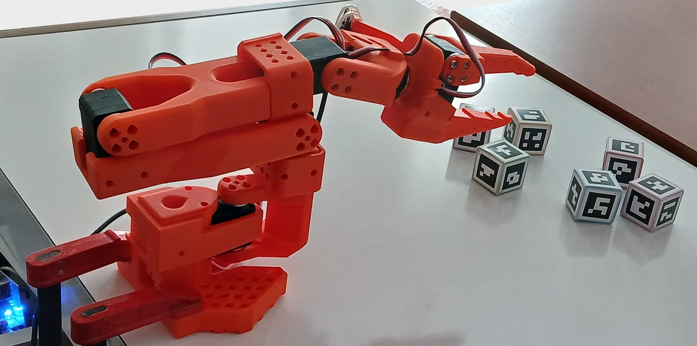
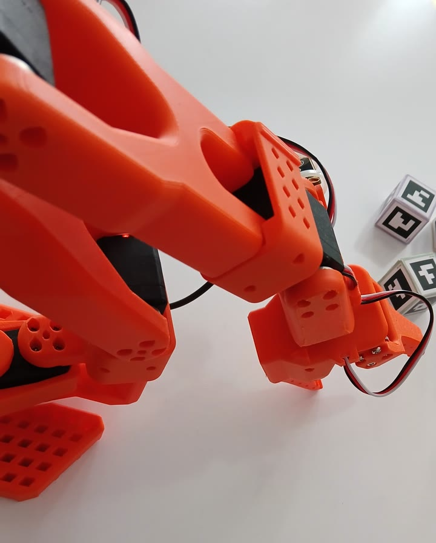
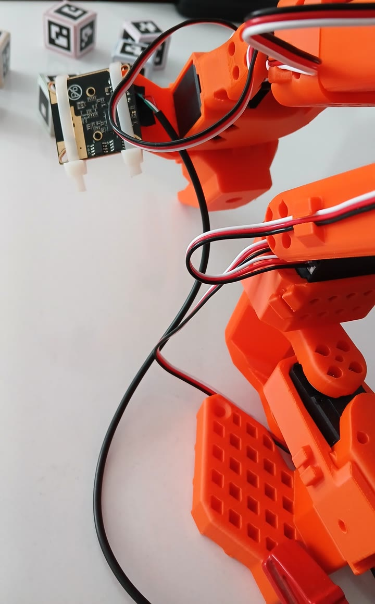
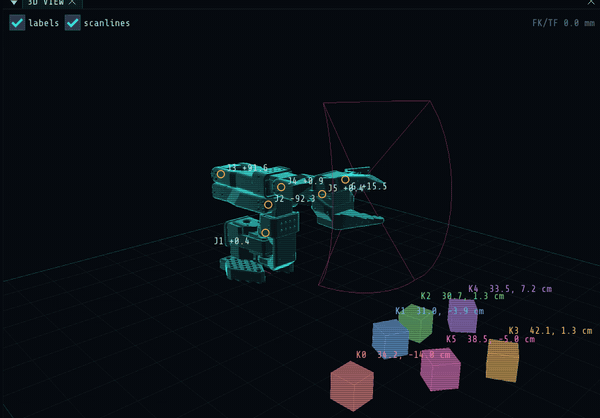
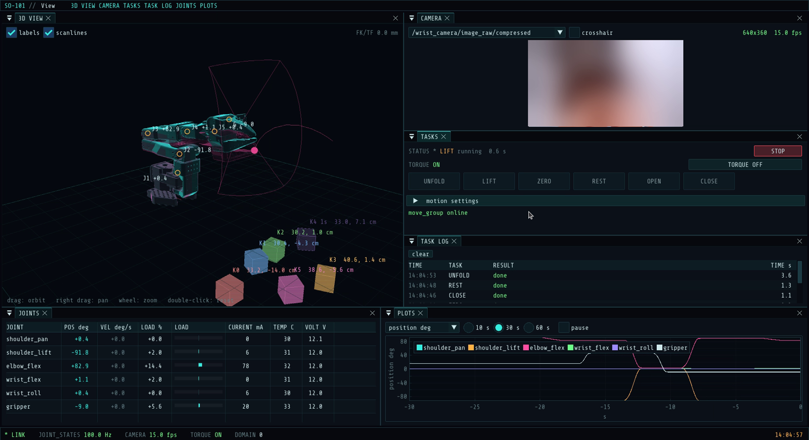
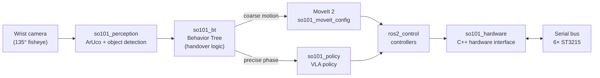

# so101-hybrid-manipulation

**Let classical kinematics and MoveIt 2 solve the easy part fast, let a learned policy (VLA) handle the precise part, and let a Behavior Tree orchestrate the two.**

<!-- TODO: enable once .github/workflows/ci.yml exists:
[](https://github.com/enesbirlik/so101-hybrid-manipulation/actions/workflows/ci.yml)
-->


[](LICENSE)

<p align="center">
  
</p>

This is a long-running, open build log of an SO-101 arm built from scratch: hardware, ROS 2 integration, perception, and learning. Progress is tracked in [`roadmap.json`](roadmap.json) and documented step by step in the [devlog](docs/devlog/).

## Research question

> **When, and under which condition, should control be handed over from a classical planner to a learned policy, and how does that handover affect success rate and task time?**

Classical motion planning is fast, predictable, and needs no data, but it struggles with the last centimetres: contact, uncertain object poses, deformable or cluttered scenes. Learned visuomotor policies handle those cases well, but they are slow to train, data-hungry, and unreliable over long free-space motions. This project tests whether a hybrid approach beats either method on its own, and studies the **handover point** as the main variable. The point can be set by distance to the target, perception confidence, or a learned trigger.

Hypotheses, metrics, and the planned experiment protocol: [docs/research/experiment-plan.md](docs/research/experiment-plan.md).

## Hardware

| Component | Details | Qty |
|---|---|---|
| Arm | SO-101 (TheRobotStudio), 3D-printed parts | 1 |
| Servos | Feetech ST3215, 12 V serial bus servo: 5 DOF + gripper | 6 |
| Servo driver | Waveshare ESP32-based bus servo driver board (USB serial). The first, non-ESP32 Waveshare board burned out | 1 |
| Power supply | 12 V 10 A constant-voltage PSU | 1 |
| Camera | USB camera, 32×32 mm module, 135° wide-angle (fisheye) lens, wrist/gripper-mounted | 1 |
| Leader arm | None. Kinesthetic teaching (gravity compensation in PWM mode) is planned instead | — |

<table>
  <tr>
    <td width="50%"></td>
    <td width="50%"></td>
  </tr>
  <tr>
    <td>Wrist and gripper over the 30 mm ArUco cubes</td>
    <td>The 135° fisheye camera module on the wrist</td>
  </tr>
</table>

### Dashboard

[`so101_dashboard`](so101_dashboard/) runs the arm through MoveIt tasks and shows it live: the URDF posed from `/joint_states`, the camera field of view and the ArUco cubes the detector found, labelled with their position in `base_link`.

<p align="center">
  
</p>



## Roadmap

Single source of truth: [`roadmap.json`](roadmap.json).

| # | Step | Status |
|---|---|---|
| 1 | Parts, BOM & 3D prints | ✅ done |
| 2 | Assembly & first motor test | ✅ done (2026-10-25) |
| 3 | Calibration, URDF matching, fisheye camera calibration | ✅ done (2026-11-01) |
| 4 | C++ `ros2_control` interface + MoveIt 2 | ✅ done |
| 5 | Perception: ArUco + object detection → classical pick & place | 🚧 active (cube pick, place and 3-high stacking on the real arm) |
| 6 | Behavior Tree + demonstration data + VLA policy | ⬜ todo |
| 7 | Hybrid orchestration & benchmark | ⬜ todo |

Legend: ✅ done · 🚧 active · ⬜ todo

## Planned architecture



> **Note:** the custom `so101_hardware` interface is the **single owner of the serial port**. MoveIt, the policy, calibration and teaching tools all reach the servos through `ros2_control`, never by opening the port themselves. This keeps bus timing deterministic and rules out two processes writing to the servos at the same time.

## Repo structure

The repository root is meant to be cloned directly into the `src/` folder of a colcon workspace:

```bash
mkdir -p ~/so101_ws/src && cd ~/so101_ws/src
git clone https://github.com/enesbirlik/so101-hybrid-manipulation.git
cd ~/so101_ws && colcon build && source install/setup.bash
ros2 launch so101_description display.launch.py
```

| Path | Role | Status |
|---|---|---|
| [`so101_description/`](so101_description/) | URDF/xacro, meshes, RViz display launch | ✅ package |
| [`so101_hardware/`](so101_hardware/) | C++ `ros2_control` hardware interface for the ST3215 bus | ✅ package (runs the arm under MoveIt) |
| [`so101_bringup/`](so101_bringup/) | Joint calibration, controller config, control launch (mock or real hardware) | ✅ package |
| [`so101_moveit_config/`](so101_moveit_config/) | MoveIt 2 configuration (pick_ik, OMPL, Pilz), demo launch | ✅ package |
| [`so101_perception/`](so101_perception/) | Wrist camera publisher, fisheye + hand-eye calibration, ArUco cube detector (cube poses in `base_link`) | ✅ package (camera, cubes) |
| [`so101_manipulation/`](so101_manipulation/) | Cube pick and place: `PickCube` / `PlaceCube` action server (look/search, close-up refinement, vertical and tilted grasps 10–43 cm, soft grasp with a hard gripper floor, stacking), CLI, fake cube for mock tests; actions in `so101_manipulation_interfaces/` | ✅ package (real arm) |
| [`so101_bt/`](so101_bt/) | Behavior Tree orchestration and handover logic | placeholder (phases 6, 7) |
| [`so101_policy/`](so101_policy/) | Demonstration data and VLA policy inference | placeholder (phase 6) |
| [`so101_dashboard/`](so101_dashboard/) | Local robot monitor (raylib + Dear ImGui): 3D view, tasks, wrist camera, joint telemetry, click a cube to pick it and the table to place it | ✅ package |
| [`tools/`](tools/) | Standalone helper scripts: Feetech bus driver, joint calibration, live joint states, teleop, camera calibration | active |
| [`docs/devlog/`](docs/devlog/) | Dated build log entries | active |
| [`docs/research/`](docs/research/) | Hypotheses, metrics, experiment protocol | draft |
| [`docs/media/`](docs/media/) | Small images and GIFs only | — |

## Devlog

- [Day 0 — Hardware & first motor test](docs/devlog/2026-10-25-day-0.md) (2026-10-25)
- [Day 1 — Bus driver, joint calibration & live RViz view](docs/devlog/2026-10-27-day-1.md) (2026-10-27)
- [Day 2 — Fisheye calibration of the wrist camera](docs/devlog/2026-10-28-day-2.md) (2026-10-28)
- [Day 3 — Hand-eye calibration, and a 10° shoulder error it uncovered](docs/devlog/2026-10-28-day-3.md) (2026-10-28)
- [Day 4 — Kinematic calibration, and the play that fooled every contact test](docs/devlog/2026-11-01-day-4.md) (2026-10-29, 2026-11-01)
- [Day 5 — ros2_control and MoveIt 2 on the real arm](docs/devlog/2026-11-06-day-5.md) (2026-11-01, 2026-11-06)
- [Day 6 — Shoulder zero, ruler and the pan shake](docs/devlog/2026-11-14-day-6.md) (2026-11-14)
- [Day 7 — Gains, a gripper that could not close, and a first grasp attempt](docs/devlog/2026-11-21-day-7.md) (2026-11-21)
- [Day 8 — Paper cubes: one crushed, then picked, placed and stacked three high](docs/devlog/2026-11-22-day-8.md) (2026-11-22)
- [Day 9 — A steadier close-up, neighbours as obstacles, and a shake that the encoders could not see](docs/devlog/2026-11-24-day-9.md) (2026-11-23, 2026-11-24)

New entries follow [`docs/devlog/template.md`](docs/devlog/template.md). Videos are linked from the entries, not stored in the repo.

## Acknowledgments

- [**TheRobotStudio / SO-ARM100**](https://github.com/TheRobotStudio/SO-ARM100): the SO-101 arm design, URDF, and meshes (Apache-2.0). See [`so101_description/ATTRIBUTION.md`](so101_description/ATTRIBUTION.md).
- [**Hugging Face LeRobot**](https://github.com/huggingface/lerobot): the open ecosystem around the SO-101, its calibration conventions, and the policy and dataset tooling this project builds on.

## License

[Apache License 2.0](LICENSE). Third-party attributions are listed in [`NOTICE`](NOTICE).
