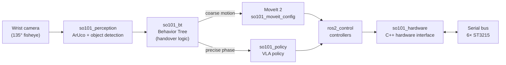

# so101-hybrid-manipulation

**Let classical kinematics and MoveIt 2 solve the easy part fast, let a learned policy (VLA) handle the precise part, and let a Behavior Tree orchestrate the two.**

[](https://github.com/enesbirlik/so101-hybrid-manipulation/actions/workflows/ci.yml)


[](LICENSE)

<!-- TODO: hero image/GIF (< 5 MB) at docs/media/hero.gif, then replace this block with:
      -->
> 📷 *Hero image coming soon: the assembled arm in action.*

This is a long-running, open build log of an SO-101 arm built from scratch: hardware, ROS 2 integration, perception, and learning. Progress is tracked in [`roadmap.json`](roadmap.json) and documented step by step in the [devlog](docs/devlog/).

## Research question

> **When, and under which condition, should control be handed over from a classical planner to a learned policy, and how does that handover affect success rate and task time?**

Classical motion planning is fast, predictable, and needs no data, but it struggles with the last centimetres: contact, uncertain object poses, deformable or cluttered scenes. Learned visuomotor policies handle those cases well, but they are slow to train, data-hungry, and unreliable over long free-space motions. This project tests whether a hybrid approach beats either method on its own, and studies the **handover point** as the main variable. The point can be set by distance to the target, perception confidence, or a learned trigger.

Hypotheses, metrics, and the planned experiment protocol: [docs/research/experiment-plan.md](docs/research/experiment-plan.md).

## Hardware

| Component | Details | Qty |
|---|---|---|
| Arm | SO-101 (TheRobotStudio), 3D-printed parts | 1 |
| Servos | Feetech ST3215, 12 V serial bus servo: 5 DOF + gripper | 6 |
| Servo driver | Waveshare bus servo driver board (USB) | 1 |
| Power supply | 12 V 10 A constant-voltage PSU | 1 |
| Camera | USB camera, 32×32 mm module, 135° wide-angle (fisheye) lens, wrist/gripper-mounted | 1 |
| Leader arm | None. Kinesthetic teaching (gravity compensation in PWM mode) is planned instead | — |

## Roadmap

Single source of truth: [`roadmap.json`](roadmap.json).

| # | Step | Status |
|---|---|---|
| 1 | Parts, BOM & 3D prints | ✅ done |
| 2 | Assembly & first motor test | ✅ done (2026-10-25) |
| 3 | Calibration, URDF matching, fisheye camera calibration | ⬜ todo |
| 4 | C++ `ros2_control` interface + MoveIt 2 | ⬜ todo |
| 5 | Perception: ArUco + object detection → classical pick & place | ⬜ todo |
| 6 | Behavior Tree + demonstration data + VLA policy | ⬜ todo |
| 7 | Hybrid orchestration & benchmark | ⬜ todo |

Legend: ✅ done · 🚧 active · ⬜ todo

## Planned architecture



> **Note:** the custom `so101_hardware` interface is the **single owner of the serial port**. MoveIt, the policy, calibration and teaching tools all reach the servos through `ros2_control`, never by opening the port themselves. This keeps bus timing deterministic and rules out two processes writing to the servos at the same time.

## Repo structure

The repository root is meant to be cloned directly into the `src/` folder of a colcon workspace:

```bash
mkdir -p ~/so101_ws/src && cd ~/so101_ws/src
git clone https://github.com/enesbirlik/so101-hybrid-manipulation.git
cd ~/so101_ws && colcon build && source install/setup.bash
ros2 launch so101_description display.launch.py
```

| Path | Role | Status |
|---|---|---|
| [`so101_description/`](so101_description/) | URDF/xacro, meshes, RViz display launch | ✅ package |
| [`so101_hardware/`](so101_hardware/) | C++ `ros2_control` hardware interface for the ST3215 bus | placeholder (phase 4) |
| [`so101_bringup/`](so101_bringup/) | Launch files and controller configs for the real robot | placeholder (phase 4) |
| [`so101_moveit_config/`](so101_moveit_config/) | MoveIt 2 configuration | placeholder (phase 4) |
| [`so101_perception/`](so101_perception/) | Camera calibration, ArUco, object detection | placeholder (phases 3, 5) |
| [`so101_bt/`](so101_bt/) | Behavior Tree orchestration and handover logic | placeholder (phases 6, 7) |
| [`so101_policy/`](so101_policy/) | Demonstration data and VLA policy inference | placeholder (phase 6) |
| [`tools/`](tools/) | Standalone helper scripts (servo bring-up, diagnostics) | README |
| [`web/`](web/) | three.js URDF viewer for the portfolio | README |
| [`docs/devlog/`](docs/devlog/) | Dated build log entries | active |
| [`docs/research/`](docs/research/) | Hypotheses, metrics, experiment protocol | draft |
| [`docs/media/`](docs/media/) | Small images and GIFs only | — |

## Devlog

- [Day 0 — Hardware & first motor test](docs/devlog/2026-10-25-day-0.md) (2026-10-25)

New entries follow [`docs/devlog/template.md`](docs/devlog/template.md). Videos are linked from the entries, not stored in the repo.

## Acknowledgments

- [**TheRobotStudio / SO-ARM100**](https://github.com/TheRobotStudio/SO-ARM100): the SO-101 arm design, URDF, and meshes (Apache-2.0). See [`so101_description/ATTRIBUTION.md`](so101_description/ATTRIBUTION.md).
- [**Hugging Face LeRobot**](https://github.com/huggingface/lerobot): the open ecosystem around the SO-101, its calibration conventions, and the policy and dataset tooling this project builds on.

## License

[Apache License 2.0](LICENSE). Third-party attributions are listed in [`NOTICE`](NOTICE).
