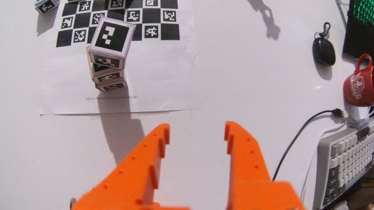

# Day 8 — Paper cubes: one crushed, then picked, placed and stacked three high

**Date:** 2026-11-22 · **Roadmap step:** 5. Perception: ArUco + object detection → classical pick & place · **Status:** in progress (pick, place and stacking work on the real arm)

On [day 7](2026-11-21-day-7.md) the arm picked up a toy with scratch scripts. Today the task got harder: six folded **paper** ArUco cubes (30 mm, one marker per face). Paper bends, so the gripper must not squeeze. By the evening the arm found the cubes, picked them by clicking on them in the dashboard, put them down where I clicked, and built a three-cube tower.

Most of the code was written by parallel coding agents, each in its own git worktree and tested on mock hardware only. The parts were merged and then run on the real arm. Almost every real-arm run found something the mock could not show. Those findings are most of this entry.

## What I did

**The first test crushed a cube.**
- The gripper got a torque limit on the servo itself (`torque_limit`, 0–1000 = 0–100 %), which can be lowered while running. A script closed the gripper slowly on a cube I held between the jaws and recorded the contact.
- The cube was crushed. Three things failed together:
  - The torque limit was published once, right after the publisher was created. The message was lost before the connection was made, so the servo stayed at 100 %.
  - Contact detection looked for the wrong sign. When the jaws are blocked, the measured angle stays *above* the command, so the lag (command − measured) goes *negative*.
  - The close ran all the way to −10°, the closed stop.
- **The fix that matters most is a floor.** The gripper is never commanded below the angle where the jaw gap equals the cube width minus 1.5 mm: 11.5° for a 30 mm cube. The servo is position-controlled, so it cannot push further than that, even if every other safety layer fails.
- The torque limit is now sent until the servo reports it back, and the gripper refuses to close otherwise. 20 % is enough to hold a paper cube.
- Measured on the real arm, empty jaws stop at 12.04° (the command is 11.48°; the servo has a ~0.5° dead band). Jaws on a cube stop at 12.5–12.7°, with 13–20 mA instead of 6 mA. "Held" is judged from that angle and current, not from the lag. With the floor this close to the cube, the lag barely moves.

**A cube detector for imperfect paper cubes.**
- The detector fits one upright cube to the corner rays of all the faces it sees, drops faces that disagree, and takes the yaw mostly from the top face.
- On the real frames from the morning, two top faces had come out **flipped**. A small marker has two possible poses, and the old detector picked the one with its normal pointing down. That put one cube 60 mm off. The new fit gets all six right.
- A per-cube tracker publishes `/cubes/tracked`: position, yaw, a "stable" flag, the spread, and when the cube was last seen. Frames are ignored while the arm moves.
- Simulated paper cubes (bent faces, shifted markers), seen from several views: 2.5 mm / 2.8° at the 95th percentile, from 7.6 mm / 5.2° per frame before. The real cubes turned out to be more regular than the simulation: their faces agree within 1 mm.
- One bad frame crashed the whole detector node in the afternoon (an empty list in the fit). Bad frames are now skipped.

**The hand-eye calibration, redone.**
- The camera pose and the joint origins dated from before the day-6 shoulder zero change.
- The calibration tool got stuck twice on its way to the board. `ros2_control` leaves the servos at P = 16 in their RAM, and at 16 the elbow stops 2.7° short of a goal under load. The tool now sets the factory P = 32 for its own run.
- 78 samples, torque on, from two sides: 1.7 px, and a board spread of 1.4 / 1.8 mm (before: 3.0 / 6.4 px with the old origins).
- The table height stays ruler-based: `table_z = 0.0`, the physical limit of a ruler optimum of +0.7 mm.

**A pick-and-place node and a click-to-pick dashboard.**
- `so101_manipulation` has `PickCube` / `PlaceCube` actions: search, approach, a close-up look, descent with a contact stop, soft close, check, lift. Transit uses straight joint-space moves checked against the table model, not MoveIt.
- A **look** service puts the camera 25 cm above the table. It sees 99 % of the work area and found 5 of 5 cubes in about 3 s.
- In the dashboard you click a cube, press PICK, click the table (or another cube), and press PLACE (or STACK). The view draws each cube in its own colour, faint if it was not seen recently and in the jaws while held. It also shows the band of the table the arm can reach.
- A pick took ~30 s at first and now takes 12–14 s.

**Reach: 14–30 cm became 10–43 cm.**
- The planner kept the jaws vertical. Far out, `wrist_flex` hits its 95° limit. The old "tilted" mode only weighted verticality, so it never actually tilted.
- Now the planner sweeps the jaw lean explicitly (5°, 10° … 45°), with the position exact. The approach and the lift follow the jaw axis.
- Beyond ~43 cm the arm is simply too short. Cubes turned 25–45° to the radial direction stop at ~37 cm: a 5-joint arm can only lean in its own vertical plane, and the other closing directions would need a wrist roll beyond the camera cable's ±90°.
- First tilted pick on the real arm: a cube at 31 cm with a 5° lean.

**A three-cube tower.** Base at 22 cm, straight in front.
- The second level is 3 cm up. The third needs the hand ~9 cm up, which is exactly where vertical jaws run out of reach at that distance.
- The first tower fell, and I caused it (see the table).
- The second one stands.

## What I learned

- **Mock tests don't find real-arm bugs of this kind.** The torque-limit state was written as an `int` where `ros2_control` wanted a `double`; the mock never runs that code. The first message was lost on a real network. The lag sign was assumed. Every new safety feature needs one empty run on the real arm before an object goes between the jaws.
- **A hard limit beats a clever detector.** The gripper floor turns "detect the contact in time" into "it does not matter if you don't".
- **The servos don't reach their goals.**
  - At P 16 the elbow and shoulder stay 2–3° short under gravity. Over the hover of a cube that put the jaws 8 mm short and 7 mm low, while the model, which follows the encoders, said they were exactly on target.
  - Fixes: a *trim* that measures the remaining error at the hover and adds it to the command; P 32 on the elbow and wrist.
  - Not P 32 on the shoulder: there it hunted ±0.5° in the unloaded, folded-back look pose. The detector then took the arm as moving and dropped every frame. The shoulder runs at 24.
- **Contact from lag needs a moving baseline.**
  - Gravity alone shifted the shoulder lag by 1.9° over a 5 cm descent. Tracking alone gave 2.8° on a stretched arm.
  - Each fixed threshold produced false contacts at 5 cm above a 3 cm cube.
  - Now the last 3.5 cm of the descent run at half speed, the first 0.4 s of that move learn the lag *while moving*, and contact is a rise of 1.5° over that. With nothing touched, the rise stays at 0.3–1.2°.
- **Where the cube sits in the jaws matters for stacking.**
  - The jaws centre the cube in the closing direction, but not along the jaw pads.
  - When the close-up look had no stable estimate (still too often), the cube sat ~1 cm off-centre along the pads.
  - On a 30 mm cube, two such offsets in the same direction put the centre of mass over the edge.

## Problems & fixes

| Problem | Cause | Fix |
|---|---|---|
| A paper cube crushed in the first gripper test | Torque limit never applied, contact sign backwards, close to −10° | Gripper floor at cube width − 1.5 mm; limit confirmed by readback; contact on a negative lag |
| OPEN in the dashboard failed | Pilz PTP needs an IK solver, the gripper group has none | Gripper goals planned with OMPL |
| Jaws 8 mm short / 7 mm low over the cube | Elbow and shoulder sag 2–3° at P 16 | Hover trim; P 32 on elbow and wrist, 24 on the shoulder |
| False contacts during the descent | Gravity and tracking change the lag on their own | Wide threshold up high; in the last 3.5 cm, half speed and a baseline learned while moving |
| Gripper "contact" at 27°, far from the cube | At 20 % torque the jaw trails the start of the closing ramp | Lag ignored above the contact window |
| Two picks went wrong in a row | A restart left an old pick node running: two action servers drove the arm | The node refuses to start if `/pick_cube` already exists |
| A place ran with empty, open jaws | Open jaws (29.6°) were read as "far above empty = holding" | Only closed jaws (≤ 17.6°) can count as holding |
| The detector died mid-session | An empty face list crashed the fit and the node | Bad frames are skipped |
| The first three-cube tower fell | After the third cube the hand could rise only 1 cm, so the open jaws still straddled the top cube; the look I called next closed the jaws there and pulled the cube off | Look/search close the jaws only after moving away; after a release the hand rises 2 cm over the cube, opening the jaws to 50° and leaning a little when straight up is out of reach |
| A far, tilted pick lost its cube in the lift | At 35 cm the tip stopped 13 mm above its goal and held the cube by its top edge | A second trim at the bottom of the descent |

## Media

The three-cube tower from the wrist camera, after the hand rose off it. The jaws are at the bottom of the image.

## Next

- Make the close-up look stable (it often falls back to the far estimate), and choose the closing direction so the open jaws miss neighbouring cubes. An agent is on both.
- Try the automatic "rise off the tower" on the real arm; today it was planned and run by hand.
- Stack directly from a tilted hold, or re-grasp automatically.
- Use the current and lag data of today's runs for a "normal current" model, so that contact means "more than expected", not "more than a threshold".
