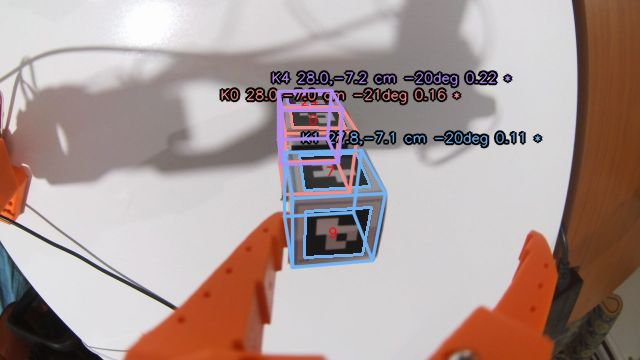

# Day 9 — A steadier close-up, neighbours as obstacles, and a shake that the encoders could not see

**Date:** 2026-11-23, 2026-11-24 · **Roadmap step:** 5. Perception: ArUco + object detection → classical pick & place · **Status:** in progress

On [day 8](2026-11-22-day-8.md) the arm picked, placed and stacked paper cubes, but two things were weak. The close-up look over a cube often fell back to the far estimate, and the open jaws did not know about the cube next to the target. Both were rewritten on mock hardware first. These two days were about running them on the real arm, chasing a shake in slow moves, and recording Build Log #4.

## What I did

**The close-up look, checked on the arm.**
- The arm stops over the cube, takes 4 new frames, and they must agree within 3 mm.
- On the real arm it now reports a shift of 2–6 mm from the far view. Before, it reported ~0 mm and was quietly using the far position.

**Other cubes as obstacles.**
- The planner checks the jaw and camera meshes against every cube it has seen. It then picks the closing direction that keeps 5 mm from the neighbours. If no direction works, it tries a smaller opening, and otherwise refuses with the neighbour's name.
- Checked on the arm:
  - two cubes 4.5–5 cm apart were picked cleanly;
  - a place 3 cm from a cube was refused before the arm moved.
- The three-cube tower was built again, now with the automatic exit. After the last release, the jaws open to 50° and the hand leans away, so it does not drag the top cube off.

**A ghost cube.**
- While the arm held a cube, the camera read that cube's own marker and placed a "cube_5, 14 cm tall" next to the stack target.
- That ghost blocked every place. Observations within 4 cm of the jaw tip are now ignored while something is held.

**The shake in slow moves.**
- Slow approaches ticked: the joints paused for up to 3.4 s, then jumped. This is stick-slip: static friction holds the joint until the error builds up, then it breaks loose.
- **Servo I term 10:** in short tests it cut the shoulder's tracking error from 1.02° to 0.19° rms. But the same evening the arm shook violently when it was pulled back towards the folded pose. Reverted.
- **Servo registers** (dead zone 0, higher start-up force): the arm shook the table while the encoders read 0.00°. Reverted.
- **What stayed:**
  - The descent is now one trajectory at one speed. Before, two goals stopped the arm between the free part and the contact zone, and the halved speed made the stick-slip worse.
  - The controller starts each new goal from its last command instead of from the measured pose. The servos hold 0.5–2° of static error, so the old way made the reference jump and briefly run backwards.

**Dashboard and LOOK.**
- **Colours:** cubes now have the colours of their printed sheet, the same as the detector's drawings.
- **Place band:** while a cube is held, the reach band on the table shows only where it can be put down. That is 10–32 cm, computed by the planner with vertical jaws; a pick can reach 43 cm with leaning jaws.
  - Four places clicked at 34 cm, and a stack on a cube at 38 cm, had been offered and then refused by the pick node. They are now refused at the click.
- **LOOK pose:** it now faces straight ahead.
  - The free-pan optimum turned the base 23° and looked like the arm was looking off to one side.
  - With the pan held at 0, the camera still covers 97% of the 15–30 × ±15 cm work area. On wider areas it covers more than before: 98% of ±20 cm (was 88%) and 82% of 12–34 × ±22 cm (was 72%).

**Build Log #4.**
- The take was recorded three ways: phone video, a screen recording of the dashboard, and a passive ROS recorder.
- The recorder saved the detector's annotated wrist images, the pick/place phases and the joint angles.
- The three were synchronised by cross-correlating the video motion with the joint speeds. The offsets came out the same within 0.1 s over 5 minutes.
- **Numbers from that take:**

  | | Result |
  |---|---|
  | LOOK | 6 of 6 cubes in 4.8 s |
  | Picks | 12.3 s and 16.1 s |
  | Stack, level 2 | 17.1 s |
  | Stack, level 3 | 25.4 s |

## What I learned

- **Encoders cannot see everything.**
  - The table shook while the encoders read 0.00°.
  - In slow moves the encoder wobble is about one tick for every gain setting, so the encoders cannot rank the settings either.
  - The wrist camera saw 0.4–1 px of jitter per frame that the encoders did not show: play and flex in the arm itself.
- **A gain that fixes one pose can break another.** Every servo gain change needs a test on the full path, including the folded and stretched poses, with someone watching and an easy way back.
- **Ask the planner, don't guess.** Both the place band and the straight-ahead LOOK pose came from running the existing planner and coverage model offline. Hand-tuned limits would have been wrong.
- **Real takes find UI gaps.** The pick node refused correctly every time, but the dashboard let me ask for the impossible. A refusal at the click is better than a refusal after the arm has moved.

## Problems & fixes

| Problem | Cause | Fix |
|---|---|---|
| Every place blocked by a "14 cm tall" cube | The held cube's marker read as another cube | Observations at the jaw tip ignored while holding |
| Slow descents ticked and shook | Stick-slip, plus a stop between two goals at half speed | One trajectory at one speed; goals start from the last command |
| Arm shook violently after a gain change | Servo I 10 hunted in the folded pose | Reverted to I 0 |
| Table shook, encoders read 0.00° | Dead zone 0 / higher start-up force in the servo registers | Restored the factory values |
| Places at 34 cm offered, then refused | Dashboard showed the pick reach (43 cm) for a held cube | Place band (vertical jaws, 10–32 cm) while holding; stack targets checked too |
| LOOK looked off to one side | Coverage optimum with a free pan (23°) | Pan held at 0; coverage 97% (was 99%) |
| Cube detector missing after a restart | `demo.launch.py` needs `cubes:=true` | Launched with it |

## Media

The three-cube tower from the wrist camera while the arm hovers over it. The detector draws each cube in the colour of its printed sheet: K4 lilac at the bottom, K0 pink, K1 blue on top.

## Next

- Merge PR #7 after an empty-table descent confirms contact detection with the one-trajectory descent.
- The far, tilted grasp on video, and stacking straight from a tilted hold.
- Roadmap step 6: Behavior Tree, demonstration data and a VLA policy.
