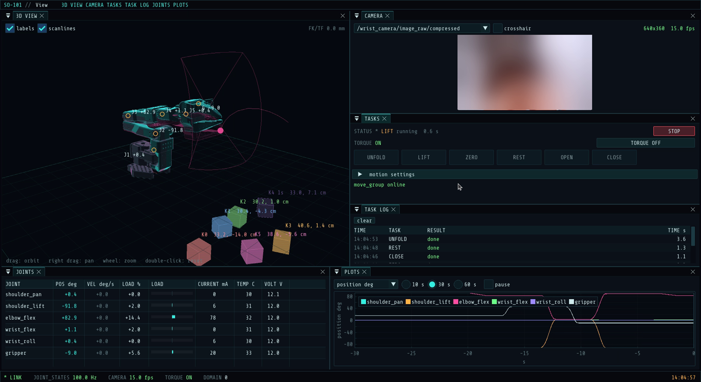

# so101_dashboard

A local robot monitor for the SO-101: one window for watching autonomous runs and starting tasks. It is a C++ ROS 2 node drawn with [raylib](https://www.raylib.com/) and [Dear ImGui](https://github.com/ocornut/imgui), with no Qt and no browser.



```bash
ros2 launch so101_moveit_config demo.launch.py use_mock_hardware:=false camera:=true rviz:=false dashboard:=true
ros2 launch so101_dashboard dashboard.launch.py    # next to a stack that is already running
```

## Panels

Every panel can be hidden and shown again: the **View** menu, the panel names in the menu bar, **F1–F6**, or the panel's close button. Panels dock anywhere by dragging their tab. *View → Reset layout* brings the default arrangement back.

| Key | Panel | Shows | From |
|---|---|---|---|
| F1 | **3D VIEW** | The URDF posed from the joint states, the table grid, joint labels, the camera field of view, the detected ArUco cubes (faint once out of view). While a task runs: the plan's goal pose as a ghost and the tool path. Cube pick and place: click a cube to select it, the reach ring on the table, the place target as a ghost cube, and a popup with the PICK / PLACE / STACK buttons (see below) | `/robot_description`, `/joint_states`, TF, `/wrist_camera/fov`, `/cubes/markers`, `/cubes/tracked`, `/display_planned_path` |
| F2 | **CAMERA** | Any `sensor_msgs/CompressedImage` topic, chosen from a list. Hidden, it unsubscribes and decodes nothing | the wrist camera; `/wrist_camera/cubes/compressed` for the cube detector's view |
| F3 | **TASKS** | Task buttons, status (with the pick/place phase and its detail), STOP; planner and speed under *motion settings*; the *CUBES* section: pick node online/offline, the held cube, PICK / PLACE / STACK, LOOK | `move_group` (`MoveGroup` action), the trajectory controllers, `/pick_cube`, `/place_cube`, `/cube_pick_place/overview`, `/cube_pick_place/state` |
| F4 | **TASK LOG** | Results of past tasks, newest first. Hover a result for the whole message and, for a pick or place, every phase with its start time | |
| F5 | **JOINTS** | Per joint: position, velocity, load, current, temperature, voltage. Right-click a column header to hide or show columns (a *TREND* sparkline column is hidden by default) | `/joint_states`, `/dynamic_joint_states` |
| F6 | **PLOTS** | One metric for all joints over 10, 30 or 60 s; click a joint in the legend to hide it; *pause* freezes the plot | the same |
| | status bar | Link state, `/joint_states` rate, camera rate, `ROS_DOMAIN_ID`, clock | |

The 3D view also checks its own forward kinematics against TF at the gripper frame (`FK/TF … mm`). It should read 0.0.

## Tasks

| Task | Does |
|---|---|
| UNFOLD | Runs `so101_bringup`'s `so101_ready.py`: out of the folded rest, elbow first |
| LIFT | Runs `so101_bringup`'s `so101_lift.py`: the hand straight up 4 cm, without MoveIt. For a hand resting on the table, which MoveIt sees inside the table and will not plan from |
| ZERO, REST | The SRDF named states of `arm`, planned and executed by `move_group` |
| OPEN, CLOSE | The `gripper` named states |
| STOP | Cancels the MoveIt goal and every goal on the trajectory controllers, and stops a running script: the arm holds where it is |
| TORQUE OFF / ON | All servos limp or holding (`so101_hardware` torque switch). OFF stops any motion first and needs a second click within 3 s: support the arm. ON holds the present pose and restarts the trajectory controllers. Tasks are disabled while the torque is off |

| PICK K*n* | `so101_manipulation`'s `/pick_cube` (`PickCube`, `cube_id` "*n*"): find the cube with the wrist camera, grasp it, lift it. Feedback phases (search, approach, refine, descend, grasp, verify, lift) show live in the status |
| PLACE HERE (x, y) | `/place_cube` (`PlaceCube`) at the clicked table point, with the cube's yaw from the slider (or *any yaw*: NaN, the smallest wrist roll change). Phases carry, descend, release, retreat |
| STACK ON K*m* (untested) | `/place_cube` with `on_cube_id` "*m*": on top of that cube, with its yaw. **Stacking has not run on the real arm yet** |
| LOOK | `/cube_pick_place/overview` (`std_srvs/Trigger`): the arm to a pose where the camera sees the table. Greyed out when the pick node does not offer the service |

One task runs at a time. Named states are read from `so101_moveit_config/config/so101.srdf`. The planner (Pilz PTP or OMPL RRTConnect) and the velocity and acceleration scaling apply to the next task.

## Pick and place a cube

Start the pick node next to the stack (`ros2 launch so101_manipulation pick_place.launch.py`, see [so101_manipulation](../so101_manipulation/README.md)); *PICK NODE online* in the TASKS panel says both action servers are there.

1. **Select:** click a cube in the 3D view. It gets a glowing outline and a *SELECTED* label, and a popup next to it shows its position, its distance from the base axis and **PICK K*n***. Clicking empty table space deselects.
2. **Pick:** PICK K*n* (popup or TASKS panel). The status line shows the phase and the node's detail; STOP cancels the goal (the arm stops where it is, the gripper is left as it is) and stops the trajectory controllers. PICK is disabled while a task runs, while the torque is off and while a cube is held.
3. **Choose where:** while a cube is held the reach ring on the table brightens: 15–29 cm from the base axis, where the pick node can put a cube down. Click the table inside it: a ghost cube marks the target and the popup shows **PLACE HERE (x, y) cm** with the yaw slider. A click outside the ring is refused with a message. Clicking another cube instead offers **STACK ON K*m* (untested)**.
4. **Place:** PLACE HERE (or STACK ON). The held cube is drawn faint where it was last seen, labelled *(held)*.

**Held cube.** The dashboard keeps its own record from the action results: a successful pick holds the cube; a successful place, a place stopped after the release (*retreat*) or refused because nothing is held, and a pick that failed before the grasp or lost the cube clear it; a pick stopped during the lift keeps it as *maybe*. *forget* in the TASKS panel drops the record (nothing moves). When the pick node publishes its own state (`/cube_pick_place/state`, latched `std_msgs/String` JSON with `busy` / `state` and `held` or `holding`: a cube id, an object with `cube`, or null), that is used instead, and the record falls back to the dashboard's own when the topic disappears.

## Controls

- **3D view:** drag to orbit, right drag to pan, wheel to zoom, double-click to reset. A **click** (left button, less than 4 px of mouse travel) selects a cube; while a cube is held it picks the place target (table) or the stack target (another cube). *labels* and *scanlines* toggle the overlays.
- **F12** or `kill -USR1 <pid>` saves `so101_dashboard.png` into the working directory.
- Layout, open panels and table columns are saved in `~/.local/state/so101_dashboard/imgui.ini`.
- `SO101_DASHBOARD_TITLE` sets another window title (a test instance next to the real one).
- **Test hook** (mock tests only): with `SO101_DASHBOARD_TEST=1` the dashboard takes GUI actions as `std_msgs/String` on `/so101_dashboard/test`: `click_world x y z` (a click where that base_link point shows on screen, through the same ray picking), `click_view u v` (fractions of the view), `pick`, `place`, `stack`, `yaw <deg>`, `look`, `stop`, `shot <file.png>`.

### How the click finds its target

The mouse position (in render-texture pixels) becomes a ray from the 3D camera (`GetScreenToWorldRayEx`). Every cube box (`/cubes/markers`, plus cubes only in `/cubes/tracked`, e.g. the FAKE cube on mock) is tested in its own frame (the ray turned by −yaw about the cube centre, then an axis-aligned box 1.3× the edge), the nearest hit wins. Otherwise the ray meets the table plane at the height the grid is drawn at (the URDF `table` link's top = `table_z`).

## Build

The first build downloads raylib 5.5, Dear ImGui 1.92.9 (docking), rlImGui and ImPlot 1.1 at pinned commits (CMake `FetchContent`, see [`CMakeLists.txt`](CMakeLists.txt)). They need the X11 and OpenGL development headers (`libx11-dev`, `libxrandr-dev`, `libxinerama-dev`, `libxcursor-dev`, `libxi-dev`, `libgl-dev`). raylib brings its own GLFW.

```bash
cd ~/so101_ws && colcon build --packages-select so101_dashboard
```

| Path | Content |
|---|---|
| `src/main.cpp` | Window, docking layout, render loop; ROS spins on a background thread |
| `src/ros_link.*` | Subscriptions and the shared `State` (mutex-guarded) |
| `src/robot_view.*` | 3D view: URDF and STL loading, forward kinematics, rim-light shader, click picking, reach ring, place ghost, popup, test hook |
| `src/camera_view.*` | Camera panel |
| `src/tasks.*` | `TaskRunner`: MoveIt goals, scripts, PickCube / PlaceCube goals, LOOK, held-cube record, STOP |
| `src/pick_place_ui.*` | PICK / PLACE / STACK buttons and checks, shared by the popup and the TASKS panel's CUBES section |
| `src/panels.*` | Joints, plots, tasks, task log and status bar panels |
| `src/layout.*` | Menu bar, panel visibility (F1–F6, saved), dock space and default layout |
| `src/theme.*` | Colours, style, font |
| `fonts/` | [Share Tech Mono](https://fonts.google.com/specimen/Share+Tech+Mono), SIL Open Font License ([`OFL.txt`](fonts/OFL.txt)) |
